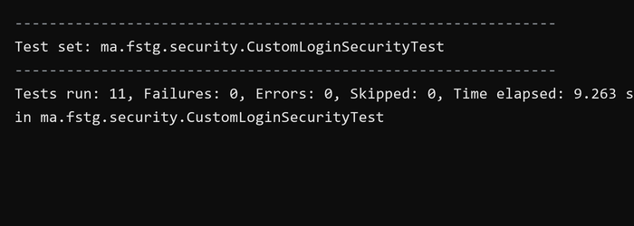
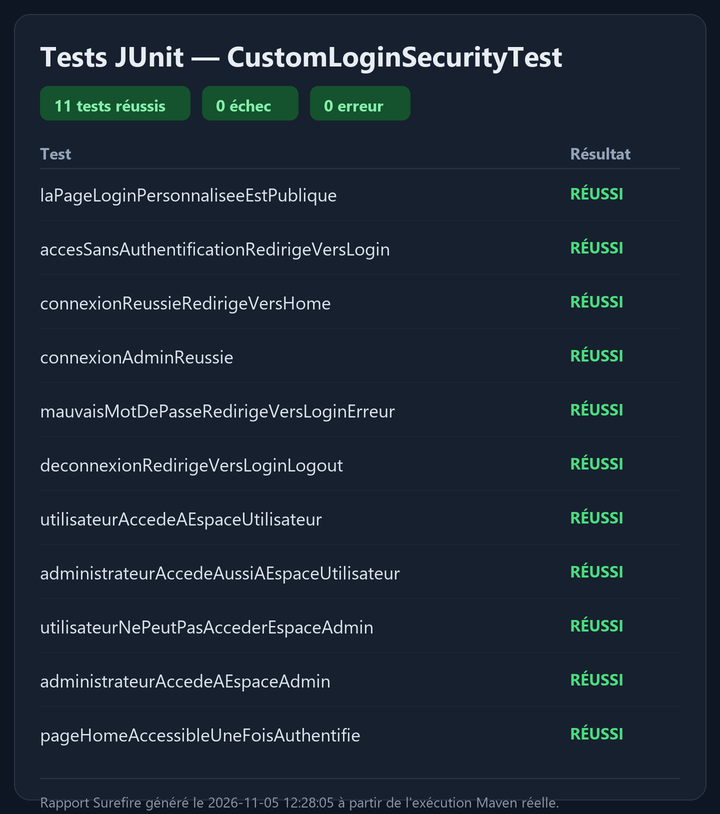
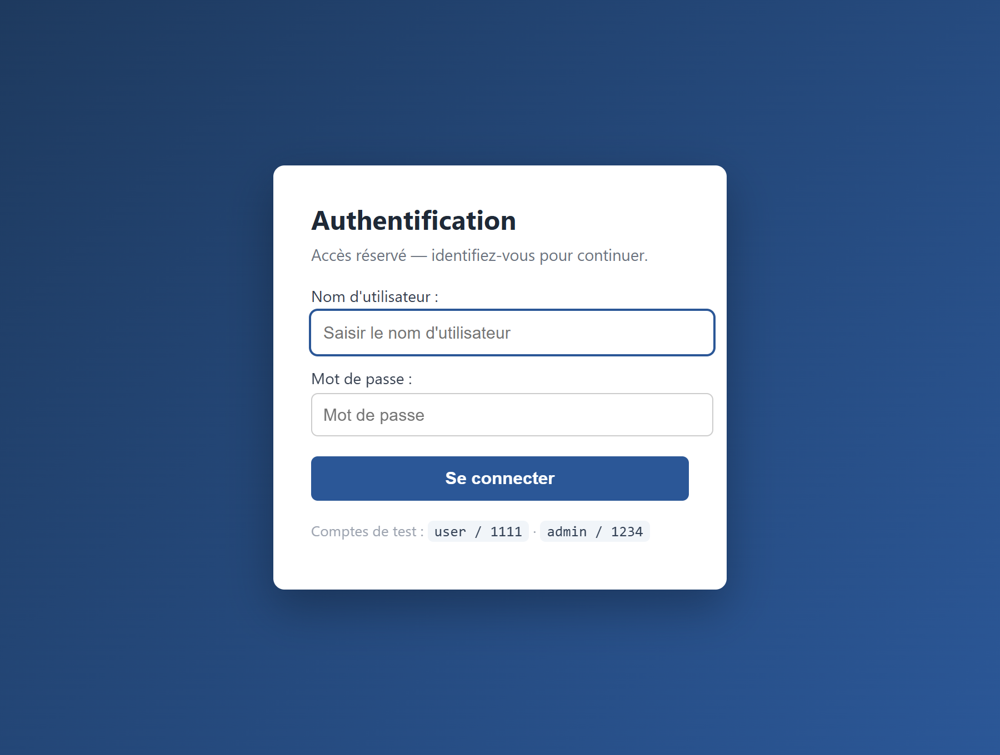
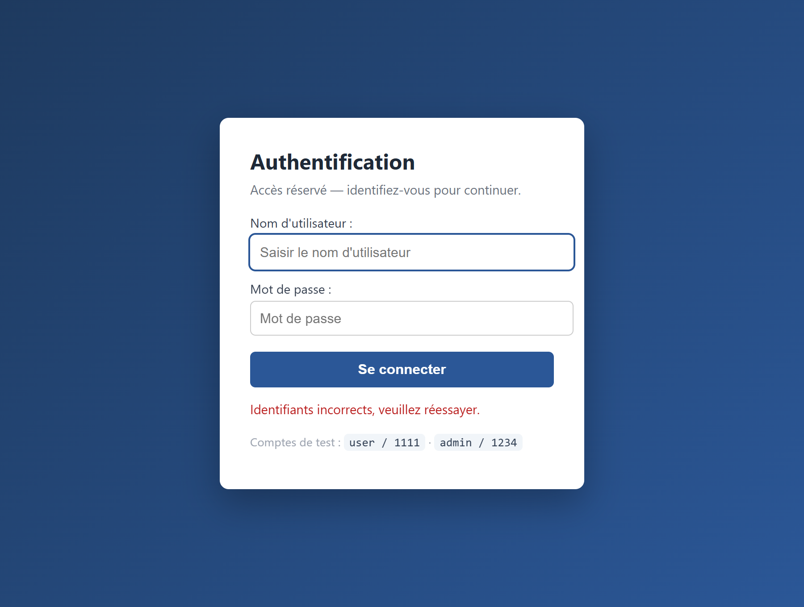
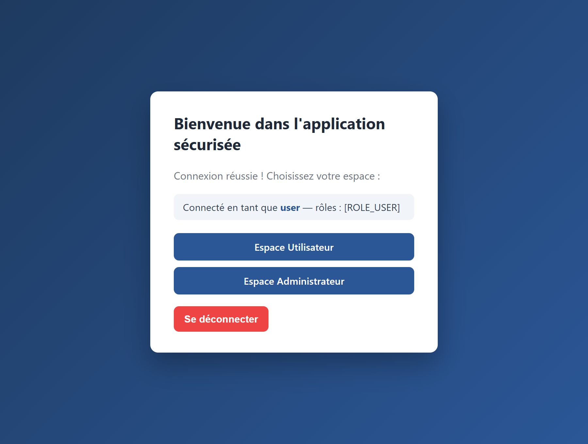
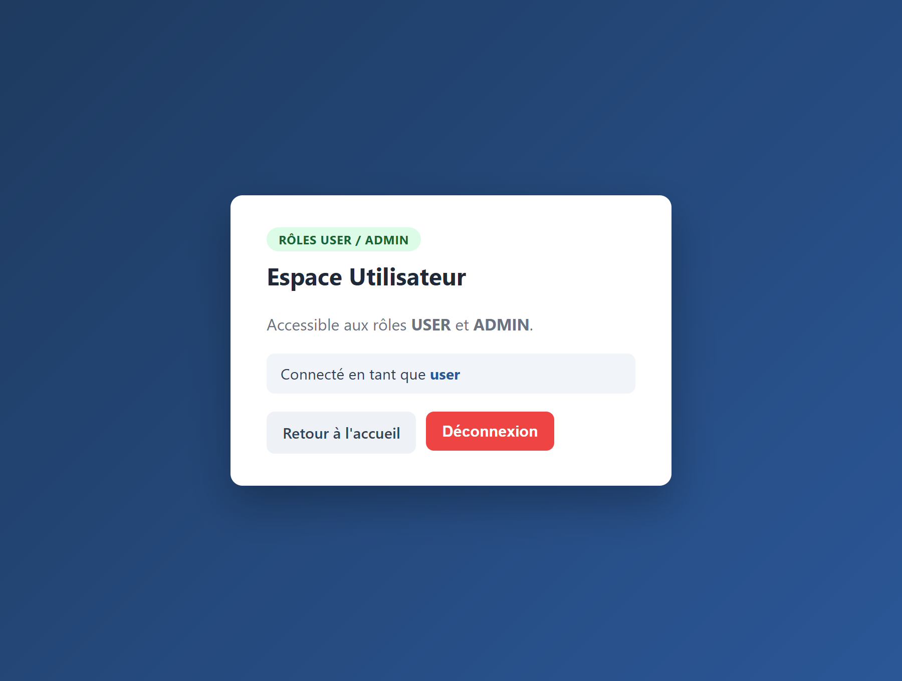
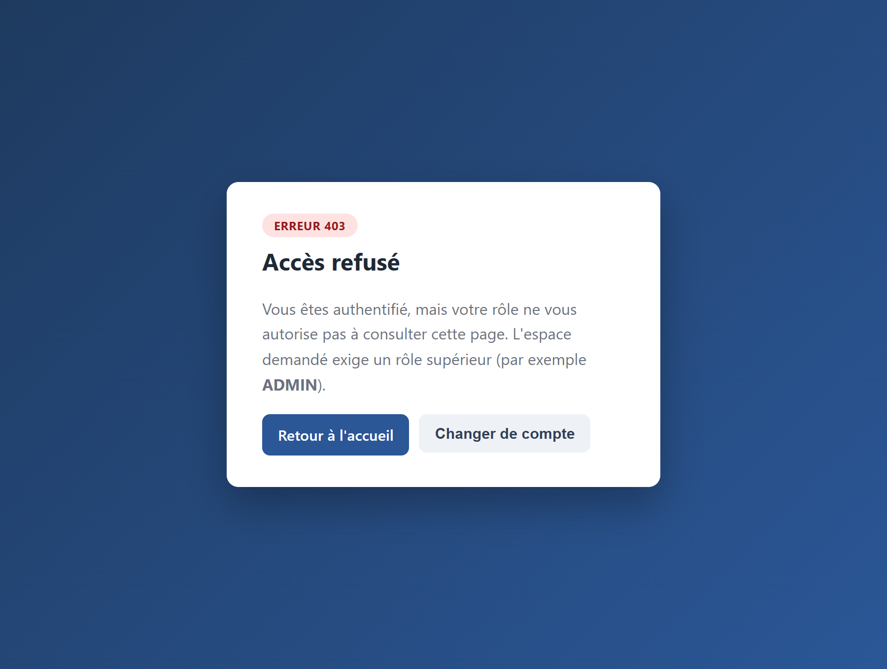
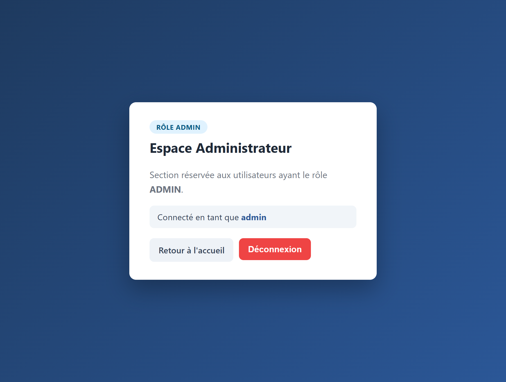
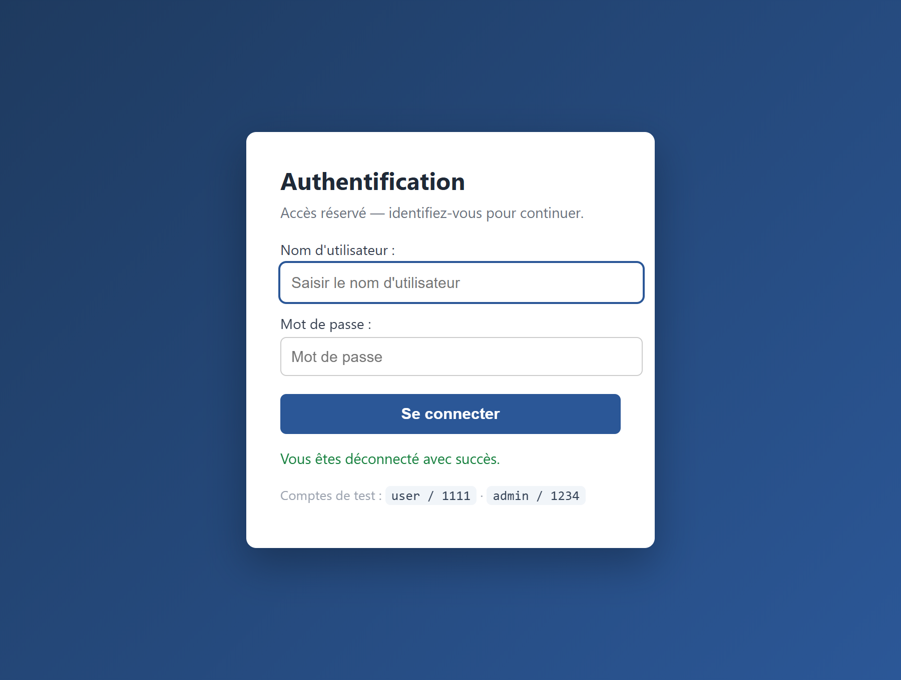

# TP10 — Formulaire de connexion personnalisé (Spring Security)

J'ai réalisé une application web Spring Boot qui **remplace la page de connexion par
défaut de Spring Security par un formulaire HTML personnalisé** (Thymeleaf). Ce TP
fait suite au TP9 (authentification en mémoire) et se concentre sur le flux
d'authentification contrôlé par l'application : branchement du formulaire sur les
endpoints de Spring Security, redirections après succès/échec, déconnexion et
messages dynamiques.

Deux utilisateurs sont déclarés en mémoire via `InMemoryUserDetailsManager` :
`admin / 1234` (rôle `ADMIN`) et `user / 1111` (rôle `USER`).

La sécurité est centralisée dans `SecurityConfig` (`ma.fstg.security.config`). Le bean
`SecurityFilterChain` configure :

- **Règles d'accès** : `/login` et `/css/**` publics ; `/admin/**` réservé au rôle
  `ADMIN` ; `/user/**` ouvert à `USER` **et** `ADMIN` ; toute autre requête exige une
  authentification.
- **Formulaire personnalisé** : `loginPage("/login")`,
  `loginProcessingUrl("/authenticate")` (URL traitée automatiquement par Spring, sans
  contrôleur), `defaultSuccessUrl("/home", true)`, `failureUrl("/login?error=true")`.
- **Déconnexion** : `logoutUrl("/logout")`, `logoutSuccessUrl("/login?logout=true")`.

Le contrôleur `AuthController` (`ma.fstg.security.web`) expose uniquement les vues
(`/login`, `/home`, `/admin/dashboard`, `/user/dashboard`) ; l'URL `/authenticate` est
gérée par le framework. Les vues sont des templates **Thymeleaf** : le formulaire de
login affiche des messages dynamiques (`param.error`, `param.logout`), et la page
`/home` affiche l'utilisateur connecté et ses rôles. La protection **CSRF** est active
(jetons injectés automatiquement dans les formulaires Thymeleaf).

J'utilise **Java 17** et **Maven** (Spring Boot 3.3.5). Pour lancer le projet :

```sh
mvn clean verify
mvn spring-boot:run
```

L'application démarre sur `http://localhost:8080/login`.

## Comptes de test

| Utilisateur | Mot de passe | Rôle    | Accès                                   |
|-------------|--------------|---------|-----------------------------------------|
| `user`      | `1111`       | `USER`  | `/home`, `/user/dashboard`              |
| `admin`     | `1234`       | `ADMIN` | `/home`, `/user/dashboard`, `/admin/dashboard` |

## Comportement attendu (vérifié)

| Action                                   | Comportement                        |
|------------------------------------------|-------------------------------------|
| Accès à une page protégée sans login     | Redirection vers `/login` (302)     |
| Connexion réussie                        | Redirection vers `/home`            |
| Mauvais mot de passe                     | Retour sur `/login?error=true`      |
| Déconnexion                              | Redirection vers `/login?logout=true` |
| `user` accède à `/admin/dashboard`       | **HTTP 403 – Accès refusé**         |
| `admin` accède à `/admin/dashboard`      | Autorisé (200)                      |

## Captures d'écran

### Résultats des tests

Captures issues de l'exécution réelle de `mvn clean verify` : **11 tests réussis**,
sans échec ni erreur. Les tests (`CustomLoginSecurityTest`) utilisent `MockMvc` et
`spring-security-test` pour traverser la vraie chaîne de filtres Spring Security et
couvrent tout le tableau de comportement ci-dessus.

**Résumé des tests Surefire**



**Rapport JUnit**



### Application en fonctionnement

Captures réelles de l'application lancée (`java -jar`), prises au navigateur
(Microsoft Edge) via Playwright.

**Formulaire de connexion personnalisé**



**Message d'erreur — identifiants incorrects (`/login?error=true`)**



**Page d'accueil `/home` après connexion réussie (utilisateur et rôles affichés)**



**Espace Utilisateur (`user`)**



**Accès refusé — `user` tente d'ouvrir l'espace Administrateur (HTTP 403)**



**Espace Administrateur (`admin`)**



**Message de déconnexion (`/login?logout=true`)**



## Preuves d'exécution (`evidence/`)

- `test-output.txt` — journal complet de `mvn clean verify`.
- `surefire-summary.txt` — résumé Surefire (`Tests run: 11, Failures: 0, Errors: 0`).
- `junit/TEST-ma.fstg.security.CustomLoginSecurityTest.xml` — rapport JUnit XML.
- `demo-output.txt` — vérification du flux complet par requêtes HTTP réelles
  (302 vers login, connexion via `/authenticate` → `/home`, 403, `error=true`,
  `logout=true`).
- `live-server-output.txt` — journal du serveur embarqué Tomcat au démarrage.
